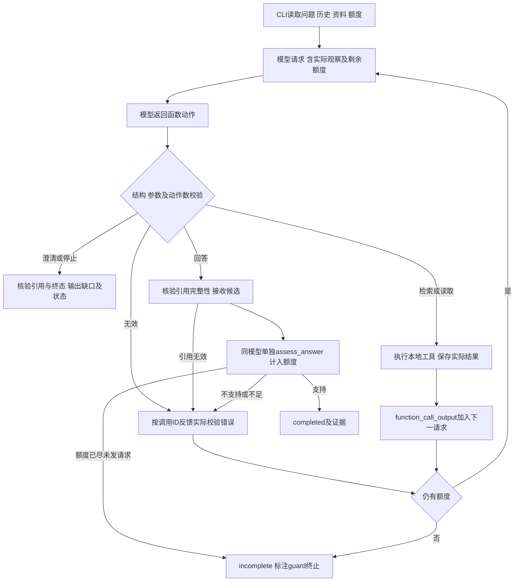

# 第3题：最小方案与动态决策

最终实现：Python CLI、本地JSON、原生受限循环、DeepSeek Responses真实适配器及独立离线Mock。无第三方Agent框架或模型SDK；标准库版本随实测Python3.10.0。实际效果、失败及源码阶段见[评估](03-evaluation.md)，不由设计图推定通过。

## 1. 目录与职责

| 文件 | 职责 |
| --- | --- |
| `src/cli.py` | 参数、输入/资料加载、显式模式、实例装配、文件与退出码。 |
| `src/agent.py` | 模型请求、动作校验/分派、观察回传、预算、读取证据表和Trace。 |
| `src/models.py` | 唯一真实DeepSeek协议、内存对话、HTTP错误与不可续接响应处理。 |
| `src/mock_model.py` | 单独的动作/复核脚本，断言收到真实工具观察；不联网。 |
| `src/tools.py` | 隔离资料、轻量检索、逐字片段、显式工具错误。 |
| `src/prompts.py` | 五业务动作、单独支持复核定义和模型策略。 |
| `src/validation.py` | 结构/输入/终态及引用完整性校验，不声称理解语义。 |
| `tests/`、`examples/`、`data/scenarios/` | 分层验证、实际证据、合成资料；Mock脚本位于tests/fixtures，和业务资料分开。 |

## 2. 数据和两个业务工具

```json
{
  "documents": [{
    "id": "D01", "title": "报销期限", "version_date": "2026-10-01",
    "content": "报销期限 30 天。"
  }],
  "faults": {}
}
```

文档必填ID、标题、有效ISO日期和非空正文；同一快照ID唯一。可选 `scope` 必须是正文中逐字存在的非空句子，不由代码推断适用范围。没有 `priority` 或 `next_action` 配置；顶层仅允许documents/faults。五场景分别提供正常、冲突、无相关、表述不足和持续读取故障。

| 工具 | 输入及范围 | 成功返回 |
| --- | --- | --- |
| `search_documents` | 非空query；limit为1—20整数，默认5。 | query、matches、total_matches、has_more；每项含ID、日期、标题、最多100字符摘要、词项分数及已有scope。 |
| `read_document` | 文档ID；start非负整数、默认0；length为1—2000整数、默认500。 | ID、日期、标题、text、start/end、总长度、has_more及已有scope。运行器成功读取后加入可信read_call_id。 |

检索对索引和查询做NFKC、大小写、少量短语归一化和中文双字匹配；标题匹配加权，按分数降序/ID升序稳定排序，日期不参与权威判断。新增“报销时效→报销期限”只改变检索词项，不改原文。原文按Python Unicode字符切片，end不包含，满足 `content[start:end] == text`。

无匹配为 `ok: true`、空matches；参数/未知文档/工具故障为 `ok: false`、`error: {code,message,retryable}`，不带伪空结果。资料损坏在加载时明确失败。`faults`只能给指定工具注入持续错误，不能指定动作、最终答案或模式。retryable是观察字段，不触发程序自动重试。

## 3. 真实闭环



图中接口不可继续时均明确failed，不降级Mock。候选或最终引用无效也反馈模型；没有下一次模型调用时，不补造后续动作。

闭环的实际代码关系：

1. `TranscriptAdapter.start`保存历史及当前问题；`decide`把完整上下文、工具定义、策略和剩余额度放入HTTP载荷。
2. 模型返回 `function_call(call_id,name,arguments)`。本地执行工具，得到实际成功或明确错误。
3. `Agent._observe`调用适配器 `observe`，追加 `function_call_output`，保留原始call_id与完整JSON结果。
4. 下一次 `decide`的input确实带该调用及返回，模型才选择新动作。不是只把结果写进日志。

`tests/test_models.py`捕获下一HTTP载荷，核对历史、预算、错误及完整观察；真实Trace显示观察ID和后续模型动作。二者结合实现检查闭环，Trace不是独立网络抓包。S2两个不同路径：A1读双方30/15后clarify；B1读双方30/30后answer和支持复核，见[实际对照](../examples/improvements/synonym-001/comparison.json)。

## 4. 模型和工程的边界

| 由真实模型决定 | 由代码保证 |
| --- | --- |
| 检索词、候选数量、读取哪个ID/区间、是否继续查证。 | 工具白名单、参数结构及范围、实际执行和观察关联。 |
| 观察零结果、冲突或错误后补查、改写、追问或停止。 | 不按场景名、数字或日期分派业务答案；故障不变空结果。 |
| 历史中的指代、回答事实、缺口、澄清项、简要依据。 | 历史原序传入；制度引用必须来自本轮成功读取。 |
| 依据证据判断冲突/适用范围，提出候选答案并复核语义。 | 逐字引用完整性、终态结构、计数、输出与模式标记。 |

五种业务动作是search_documents/read_document/clarify/answer/stop；assess_answer是候选回答后的内部复核动作。代码分派动作名属于执行骨架，不替模型选择下一个业务动作。

“冲突无依据不得选择”“资料外不得用常识补制度”通过模型策略和支持复核约束；代码没有通用制度推理器。样本表现正确不构成对所有语义错误的硬保证。

## 5. 适配器及协议取舍

唯一真实类 `DeepSeekResponsesAdapter` 使用标准库HTTPS，固定端点 `https://api.deepseek.com/responses`。配置DEEPSEEK_API_KEY/DEEPSEEK_MODEL；本次实际模型deepseek-flash。请求包含model/input/instructions/tools、tool_choice=required、reasoning.effort=none、max_output_tokens=3000。

依据[DeepSeek Responses文档](https://api-docs.deepseek.com/guides/responses_api/)与[工具调用文档](https://api-docs.deepseek.com/guides/tool_calls/)，标准载荷不发送store/include/parallel_tool_calls，也不依赖服务端strict保证。定义中的strict在发送前去掉，本地再校验。实际多动作响应确实出现，整批拒绝并回传各调用错误，未执行其中任意工具；空动作反馈，重复/缺失ID不能安全续接则失败。

应用内保留完整协议续接项，认证头及内部推理不进入Trace。每次网络超时30秒，不做隐藏HTTP重试；HTTP错误不回显不可信响应体，拒绝重定向。API尝试数在发送前递增，失败尝试仍计数，不等同计费token或成功次数。

独立 `MockAdapter`读取动作脚本，并可校验此前观察是否符合预期。工具仍实际执行，脚本结论和复核仍是预设，API计数为0。真实配置/服务失败保持real并报告，不构造Mock成功。

## 6. 额度、异常和引用

默认8次所有模型请求共用预算，包含无效响应、修正、候选和支持复核；每个响应最多执行一个动作。额度用尽时返回incomplete/EXECUTION_LIMIT，记录未再次观察的调用，不追加“总结成功”请求。输入历史最多20条，问题加历史最多20,000字符；本项目没有全局硬实时保证。

工具意外异常转换为TOOL_EXECUTION_ERROR，只暴露异常类型，作为观察回传；接口/不可续接协议故障标记adapter终止，初始化和guard终止分别记录。模型可自行停止failed/incomplete，也可clarify。

引用分两层：

1. **完整性**：本轮读取句柄存在、读取成功、ID/版本相同、start/end落在已读区间、quote逐字匹配。检索摘要和旧历史不能代替本轮读取。
2. **支持关系**：候选answer通过同模型单独assess_answer，判断事实是否受证据支持、是否忽略冲突或范围；不支持/不足时把结果反馈模型，仍耗预算。clarify/stop不进行该语义复核，完整性仍检查。

首次真实句柄错误后，成功读取数据显式提供read_call_id，错误反馈仅列实际成功读取的句柄和区间。没有放松引用校验。支持复核可能和生成犯同样错误，不能把模型supported当成独立人工证明。

## 7. Trace和证据

JSONL事件包括run_started/model_request/model_action/model_actions_rejected/tool_result/validation_error/citation_check/answer_review/transition/run_finished。 `model_action`在结构/动作校验通过后才产生；单个无效调用可能只记录拒绝动作与错误，并非逐请求原始响应转储。多动作拒绝事件保留该批实际调用及参数。工具结果保留完整小型JSON及最多600字符摘要；后续动作发生后才记录transition和模型提供的公开简要依据（最多300字符）。不要求或保存内部思维过程。

每次CLI新建证据目录，拒绝覆盖。五文件记录输入、输出、实际事件、资料快照、日期/模式/模型/额度/命令/源码与数据哈希。已知认证值做脱敏；原始卷面、私有配置不属于交付输入。目录/写入失败不伪报保存成功。

## 8. 范围与技术取舍

| 选择 | 原因与代价 |
| --- | --- |
| CLI/本地JSON/标准库 | 优先核心链路、复现简单；需要自己维护协议和状态，未提供界面/服务部署。 |
| 词项检索及短语表 | 可解释、易做资料对照；泛化有限，可能漏召回/误召回。 |
| 单动作和固定预算 | 明确观察→动作关系、限制无效循环；模型多动作会被拒绝并消耗额度。 |
| 同模型语义复核 | 分开处理片段存在与支持关系，复用唯一服务；增加请求且不是独立裁判。 |
| 每次新目录及哈希 | 保存失败和版本，便于复查；需要人工选择新目录及区分历史与最终源码。 |

本轮文档整理没有更改运行源码或增加基础设施。S2六业务真实复测已完成，见[最终报告](../examples/real/final-six-2026-11-01/README.md)。四项真实边界整批重跑、独立人工语义复核、稳定性、大样本质量及干净环境仍未验证；公开交付入口见[SUBMISSION](../SUBMISSION.md)。
