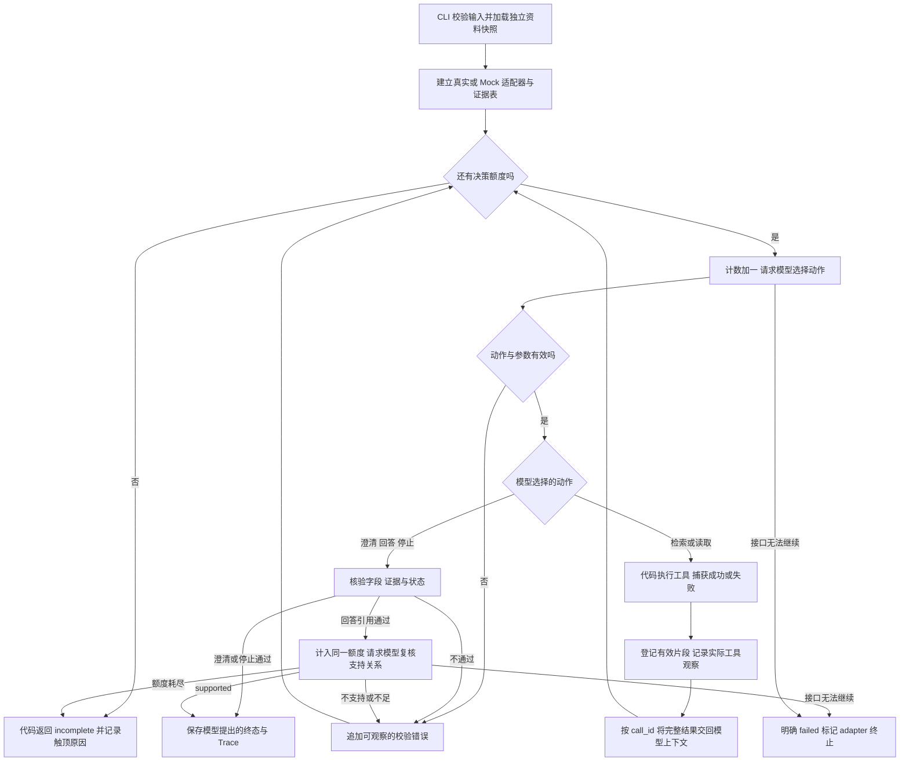

# 第 3 题：企业知识问答 Agent——最小架构

日期：2026-11-01（Asia/Shanghai）。CLI、两种模式、模型循环、引用完整性核验、独立支持关系复核与 Trace 已实现，真实服务按用户选择改为 DeepSeek。最新实际结果见[真实报告](../examples/real/deepseek-2026-11-01/README.md)及 [03-evaluation](03-evaluation.md)。

当前离线回归70项通过，12项真实测试在该报告中为未运行；单词条映射增量及三组真实对照见[改进报告](../examples/improvements/synonym-001/README.md)。旧十项真实验收属于映射前源码，未在本轮整批重跑。第 12—13 节是保留的阶段历史，不代表当前接入或验证状态。

## 1. 依据、当前事实与技术选择

依据 [需求与验收矩阵](01-requirements.md)、现有 [工具实现](../src/tools.py) 与 [工具阶段说明](../README.md)。

- **已有**：资料、工具、CLI、两种适配器、受限循环、两类核验与 Trace；49 项离线测试通过，见 [当前实现报告](../examples/checks/agent/report.json)。此前 18 项工具报告为历史版本。
- **待验证**：真实模型接入、动态路径与语义质量、干净环境复现。用户选择本轮先离线验证。
- **原题硬性要求**：模型选择动作、工具执行、观察回传、模型再决定；可核验引用；资料冲突查证；执行上限；真实/离线边界；三类场景材料及至少两条动态路径。
- **用户约束**：按指定阶段完成、优先 CLI、中文协作、如实记录验证和 AI 辅助范围。
- **本项目选择**：Python 3.10+、同步 CLI、本地 JSON、两个业务工具、五种模型动作、一种真实模型接口、一种独立离线适配器、最多 8 次模型决策。这些具体机制不是原题指定的唯一方案。

真实模型接入选择 **DeepSeek Responses API 的自定义函数调用**，由 Python 标准库 `urllib.request` 发起 HTTPS JSON 请求；仅保留这一种真实适配器及独立 Mock，不引入 Agent 框架、向量数据库、Web 服务或 SDK。取舍是需要自行维护协议、校验与错误转换。本次实际模型为 `deepseek-flash`。

官方协议由应用执行工具，再以 `function_call_output` 交回结果，模型继续选择动作。本项目不会由接口自动执行本地函数。[DeepSeek Responses 文档](https://api-docs.deepseek.com/guides/responses_api/)、[工具调用文档](https://api-docs.deepseek.com/guides/tool_calls/)

## 2. 数据、场景与运行输入

### 2.1 文档格式

每个场景仍是一个独立 JSON 文件，顶层只有 `documents` 与可选 `faults`。

```json
{
  "documents": [
    {
      "id": "D01",
      "title": "报销期限",
      "version_date": "2026-10-01",
      "content": "报销期限 30 天。"
    }
  ]
}
```

字段约束：

| 字段 | 规则 |
| --- | --- |
| `id` | 非空字符串，同一快照中唯一。当前用 D01、D02 等；一份快照中不放同 ID 的多版本。 |
| `title` | 非空标题，辅助检索，不单独证明制度事实。 |
| `version_date` | 有效的 `YYYY-MM-DD` 日期，保留来源版本；日期较新不自动代表优先适用。 |
| `content` | 非空原文，保留换行、标点、全半角；引用偏移针对该原文。 |
| `scope`（可选，已实现） | 仅在原文明确存在适用范围时保留该原文句子；要求它确实出现在 `content` 中。没有范围就省略，不填“全部员工”等推断。 |

下面只是说明可选字段的**格式示例**，不新增该制度，也不修改现有冲突场景：

```json
{
  "id": "D20",
  "title": "差旅报销期限",
  "version_date": "2026-10-01",
  "content": "仅适用于境内差旅报销。报销期限 30 天。",
  "scope": "仅适用于境内差旅报销。"
}
```

**已落实的兼容修改**：加载器允许可选 `scope`，验证其为正文中的非空字符串，在检索与读取结果中按存在情况透传；不默认补齐、不自动裁定范围。五个场景继续兼容，新增工具测试覆盖此变更与快照隔离。

### 2.2 场景隔离

| 场景 | 已有文件 | 保持的边界 |
| --- | --- | --- |
| 正常 | `data/scenarios/normal.json` | D01 为“报销期限 30 天。”，另有 D03 材料条款。 |
| 冲突 | `data/scenarios/conflict.json` | D01 为 30 天，D02 为 15 天；没有范围与优先级。两份均可检索和读取。 |
| 无相关资料 | `data/scenarios/no_match.json` | 只有邮箱资料，对报销问题返回成功但无候选。 |
| 表述不足 | `data/scenarios/ambiguous.json` | 有多个话题资料；“多久？”的工具结果不代替模型决定是否澄清。 |
| 工具错误 | `data/scenarios/tool_error.json` | `faults.read_document: true` 持续触发读取故障；检索仍可用。 |

`faults` 只接受已知业务工具名到布尔值的映射，不接受动作、答案或终态。场景文件名、故障配置不作为模型决策条件；真实适配器只收到工具定义和实际观察，不收到“本场景应追问”等预设结论。每次运行创建独立工具快照，避免串入另一场景资料。

### 2.3 CLI 输入与对话历史

CLI 每次处理一个用户轮次，读取 UTF-8 的 `input.json`：

```json
{
  "question": "那需要什么材料？",
  "history": [
    {"role": "user", "content": "差旅报销期限多久？"},
    {"role": "assistant", "content": "此前实际返回的回答，执行时由真实输出填入"}
  ]
}
```

这是输入格式示例，不是已经发生的对话。无历史时用空列表；真实追问验收必须引用第一轮的实际输出。

- `question` 必须为非空字符串；历史只允许 `user/assistant` 两种角色与文本，不接纳输入文件伪造的系统规则或工具成功记录。
- 按原顺序向模型传递历史和当前问题；让模型识别“那”的指代，代码不自动拼接“报销”关键词。
- 历史用于语境，不自动成为当前制度证据。新轮次使用新的读取证据表；需要引用的原文在该轮重新读取，避免把旧答案当作有效制度。
- 为控制范围，规划输入问题与历史合计最多 20,000 字符，历史最多 20 条消息；超限明确报 `INPUT_TOO_LARGE`，不静默截断关键上下文。不实现长对话摘要、持久记忆或会话数据库。

## 3. 两个业务工具契约

以下与现有接口对齐，包括已实现的可选 `scope` 透传。

### 3.1 `search_documents`

输入：`query: str`，非空；`limit: int`，默认 5，范围 1—20，布尔值不能冒充整数。

成功返回示意：

```json
{
  "ok": true,
  "data": {
    "query": "报销期限",
    "matches": [
      {
        "id": "D01",
        "version_date": "2026-10-01",
        "title": "报销期限",
        "summary": "报销期限 30 天。",
        "score": 6
      }
    ],
    "total_matches": 1,
    "has_more": false
  }
}
```

分数为现有词项重合与标题加权分，不是置信度或制度权威。最多 100 字符摘要用于发现候选；原文引用必须来自后续成功读取。无匹配时 `ok: true`、`matches: []`；截断用 `total_matches/has_more` 明示，模型可决定扩大 `limit` 或改写查询。日期不参与优先级排序。

### 3.2 `read_document`

输入：`document_id: str`，非空；`start: int`，默认 0，非负；`length: int`，默认 500，范围 1—2000。

成功返回示意：

```json
{
  "ok": true,
  "data": {
    "id": "D01",
    "version_date": "2026-10-01",
    "title": "报销期限",
    "text": "报销期限 30 天。",
    "start": 0,
    "end": 10,
    "total_length": 10,
    "has_more": false
  }
}
```

位置是 Python Unicode 字符索引，`end` 不包含在片段内。保证 `content[start:end] == text`，不改写、归一化正文。模型观察 `has_more` 后自行决定是否继续读取；代码不因分页自动替模型追加调用。

### 3.3 统一错误

业务工具错误返回：

```json
{
  "ok": false,
  "error": {
    "code": "TOOL_UNAVAILABLE",
    "message": "已注入故障：原文读取工具不可用",
    "retryable": false
  }
}
```

错误不带 `data` 或空 `matches`。现有错误码为 `INVALID_ARGUMENT`、`DOCUMENT_NOT_FOUND`、`TOOL_UNAVAILABLE`。运行器还需把未预期的工具异常转换为 `TOOL_EXECUTION_ERROR`，记录脱敏异常类型，将失败观察反馈给模型；不伪报“无相关资料”，不自动选择业务重试。

资料文件不存在、损坏或元数据非法时，现有加载器抛出 `DatasetError`。CLI 应在模型循环前将其转换为明确的 `DATASET_ERROR` / `failed`；初始化失败不是模型作出的业务决定。错误日志不包含密钥、完整请求头或卷面个人信息。

## 4. 模型动作与最终输出

### 4.1 五种动作

向真实模型暴露五个自定义函数。前两个执行本地业务工具，后三个提交待校验的终态，不产生外部副作用。`tool_choice` 要求选择函数，但**不固定函数名**。

| 动作 | 模型填写的参数 | 运行器处理 |
| --- | --- | --- |
| `search_documents` | `query`、`limit`、`decision_summary` | 校验后调用现有检索工具；将结果回传模型。 |
| `read_document` | `document_id`、`start`、`length`、`decision_summary` | 校验后读取原文；登记成功读取证据；将结果回传模型。 |
| `clarify` | `answer`、`citations`、`gaps`、`decision_summary` | 核验引用和字段；通过后结束当前轮，状态为 `needs_clarification`，等待用户下一轮输入。 |
| `answer` | `answer`、`citations`、`gaps`、`decision_summary` | 引用完整性通过后由同一模型单独复核支持关系；仅 `supported` 才接受 `completed`。至少一条有效引用且 `gaps` 为空。 |
| `stop` | `answer`、`citations`、`gaps`、`status`、`decision_summary` | `status` 仅允许 `incomplete/failed`；要求说明缺口或原因，通过后结束。 |

所有动作的 `decision_summary` 是模型给出的简短、可公开说明，例如“候选期限不一致，需要核对原文”，不是内部思维过程。它记录在 Trace 中；工具分派前先移除该字段，不向现有工具传入多余参数。不能由代码编造模型依据。

函数参数采用严格对象结构、拒绝多余字段。模型对工具函数显式填写默认参数；实际类型、范围仍由运行器校验。缺省、错误 JSON 或无效字段的反馈是工程校验，不是替模型确定下一业务动作。

### 4.2 最终输出契约

以下是**设计示例，非实际运行输出**：

```json
{
  "run_id": "由程序生成",
  "mode": "real",
  "model": "本次实际配置并返回的模型标识",
  "answer": "根据 D01，报销期限为 30 天。",
  "citations": [
    {
      "document_id": "D01",
      "version_date": "2026-10-01",
      "quote": "报销期限 30 天。",
      "start": 0,
      "end": 10,
      "read_call_id": "本轮成功读取动作的实际 call_id"
    }
  ],
  "gaps": [],
  "status": "completed",
  "termination_source": "model"
}
```

`run_id/mode/model/termination_source` 由程序填入，模型不能覆盖。业务字段由模型提出，代码校验后接受；不通过则返回校验观察让模型修正。

| 状态 | 含义与约束 |
| --- | --- |
| `completed` | 模型选择回答，结构和引用核验通过；不允许存在已声明但未解决的缺口。结构通过不等于业务语义已被数学证明。 |
| `needs_clarification` | 模型选择澄清，例如范围不明、文档冲突；输出明确的问题及非空 `gaps`。无证据时不强制生成引用。 |
| `incomplete` | 模型说明资料不足，或代码因执行额度耗尽而停止。保留原因，不猜测答案。 |
| `failed` | 模型因工具故障停止，或模型接口/初始化发生无法继续的错误。区分由模型还是代码终止。 |

`termination_source` 区分 `model`、`guard`、`adapter`、`initialization`。代码兜底只输出故障/未完成说明和已有有效证据，不生成制度答案，不冒充模型主动停止。

## 5. 一种真实适配器与独立离线适配器

### 5.1 公共接口

每个运行实例只选择一个适配器，生命周期与当前用户轮次相同：

1. `start(question, history, tool_definitions, instructions)`：建立模型输入；不执行工具。
2. `decide(budget, review=None)`：一次模型请求，返回调用项或明确错误；`review` 非空时仅暴露支持关系复核函数，不执行额外业务工具。
3. `observe(call_id, result)`：将实际工具结果或校验错误按调用 ID 附加到模型上下文；自身不决定下一动作。
4. 再次 `decide`：必须携带 `observe` 中的结果；由模型重新选择五种动作之一。

业务层只接受这个接口，不读取场景名选择路径。适配器负责协议与模式标识，运行器负责工具、保护、证据和输出。禁止另写一条“真实模式”固定业务流程绕开此接口。

### 5.2 `DeepSeekResponsesAdapter`（已真实调用）

- 单一端点：`POST https://api.deepseek.com/responses`；CLI 配置 `DEEPSEEK_API_KEY` 与 `DEEPSEEK_MODEL`，密钥只从当前进程环境读取。真实测试提供隐藏输入包装入口，认证不进入命令参数、文件或报告。
- 请求含 `model`、完整 `input`、`instructions`（约束和预算）、工具定义、`tool_choice: "required"`、`max_output_tokens: 3000` 和 `reasoning: {"effort": "none"}`。只评审候选答案时提供独立 `assess_answer` 定义及候选。
- 按官方标准端点能力，不发送不受支持的 `store`、`include`、`parallel_tool_calls`；移除函数的服务端 `strict` 标记。不能假设服务端严格参数或单动作保证。本地完整校验参数，多个调用整批拒绝，原样记录实际调用并反馈错误，消耗预算。[Responses 兼容边界](https://api-docs.deepseek.com/guides/responses_api/)
- 采用应用内维护完整输入的方式。保留 API 返回的协议续接项；把实际结果附加为带原始 `call_id` 的 `function_call_output`。协议项只在内存续接，不将内部推理写入 Trace。
- 成功读取时在正文数据显式加入可信 `read_call_id`，使模型可以逐字复制引用句柄；引用错误反馈只列出本轮实际成功读取的句柄及来源区间。模型仍决定下一动作，代码不生成业务答案。此改动来自首次真实运行暴露的句柄不可见问题，旧失败包完整保留。
- 每次网络超时 30 秒，无隐藏 HTTP 重试；HTTP/连接失败转为明确 `MODEL_API_ERROR`；拒绝重定向，避免认证头被转发。响应未完整结束或不可续接的格式错误明确失败。多个/空动作属于可反馈的本地校验错误。
- 不切换供应商、模型或 Mock。模型标识、响应 ID、实际工具观察可公开，认证头不记录；仅发送本项目合成资料及本次提供的对话。

2026-11-01 授权联网进程实际取得模型列表并完成真实生成请求；普通受限进程曾发生 Windows 10013，不能混写为认证失败。协议单测与真实业务报告分开保存，详见评估记录。

### 5.3 `MockAdapter`（已实现，单独文件）

- 用 `--mode mock` 显式启用；不读取模型密钥、不进行网络请求、不依赖真实适配器初始化。
- 使用独立的测试动作脚本，逐步提供动作，并检查运行器是否把上一工具结果送入 `observe`。脚本结束或观察不符时返回明确的 Mock 脚本错误，不自动补成功答案。
- Mock 可按观察模拟调用、澄清、终止等，以验证工程流程；它仍是受控脚本，不能证明真实模型会这样选择。
- 模型脚本与 `data/scenarios/` 严格分开，不能向场景 JSON 塞入 `answer/next_action`。Mock 和真实模式复用同一工具执行、参数校验、证据核验、额度和记录代码。
- 终端、最终 JSON、Trace、运行元数据都必须标 `mode: mock`、模型标识如 `mock-script-v1`；输出保存到 `examples/mock/`，不与 `examples/real/` 混放。

## 6. 调用流程与闭环检查

### 6.1 简明流程



### 6.2 必须落实的协议不变量

下面为实现的协议关系示意，实际调用以 Trace 为准：

```text
模型请求 n -> 模型返回 function_call(call_id, name, arguments)
运行器校验 -> 执行该业务工具 -> 得到实际 result（成功或明确错误）
adapter.observe(call_id, result)
  -> 保留对应模型调用项
  -> 附加 function_call_output(call_id, JSON(result))
下一次 adapter.decide -> 模型请求 n+1 确实包含上述调用与结果
模型返回下一动作 -> 程序此时才知道它选择补查、读取、澄清、回答或停止
```

这里的关键不是把观察“写进日志”，而是把它放入**下一次模型请求**。模型看到的是完整、限量的工具返回；Trace 可用摘要，不能把日志摘要误当模型实际收到的全部证据。

- 一次合法模型回复最多执行一个动作；运行器根据动作名分派属于执行骨架，不依据“冲突场景”“零结果”“15 天”等业务条件替模型选动作。
- 成功检索后不能由代码自动读取所有候选或直接生成回答；后续读取仍须来自模型的新调用。
- 工具失败也进入 `observe`，由模型决定是否改写检索、尝试其他原文、受限重试或停止。不是自动重试脚本。
- 参数错误、未知动作或引用核验失败进入校验反馈；模型仍有额度时自己修正。若一次响应包含多个调用，不执行其中任何一个，并为可关联的调用返回单动作约束错误，避免遗漏调用结果破坏协议。
- 达到额度后不额外请求“总结答案”，不把已有摘要加工成成功结论；如实返回代码保护触发的未完成状态。

**实现检查结论**：`Agent._observe` 提交实际结果，`TranscriptAdapter.observe` 保存带原调用 ID 的 `function_call_output`，`DeepSeekResponsesAdapter.decide` 将完整上下文放入下一 HTTP 载荷。离线请求捕获测试检查完整观察、错误与历史进入下一载荷；真实包记录模型动作、工具结果、下一请求的观察 ID 和之后动作。当前正常与冲突已形成两条真实路径，详见真实报告。Trace 本身不是独立网络抓包，仍需结合适配器实现及协议测试核对。

## 7. 模型与代码职责边界

| 模型决定 | 代码保证 |
| --- | --- |
| 检索词、是否改写或扩大候选范围。 | 白名单动作、参数类型/范围、实际执行与结果回传；不隐藏错误。 |
| 读哪份文档、哪个片段，是否继续分页。 | 原文不改写、偏移正确、元数据保留、成功读取证据登记。 |
| 是否资料不足、需要哪项澄清。 | 输出结构和状态约束；代码不补造缺失制度。 |
| 是否冲突、如何查证、能否依据范围解释差异。 | 不按日期或 ID 自动选制度；保留双方资料和读取结果。冲突语义的正确识别仍需实测评估。 |
| 依据原文作答，或选择停止并说明原因。 | 引用真实性、读取来源、版本与位置核验；无效终态不得当完成输出。 |
| 简要公开决策依据。 | 只记录可观察动作与简要说明，不编造依据或采集内部思维过程。 |
| 额度内下一业务动作。 | 请求次数与工具调用数记录、超时、触顶停止、模式隔离和脱敏。 |

`answer` 提交被代码拒绝时，代码只指出具体不满足的约束，不替模型生成正确制度答案。代码保护强制终止属于明确标识的工程行为，不冒充动态决策。

## 8. 额度、异常与引用核验

### 8.1 额度与异常

- 默认 `max_steps = 8`，可由 CLI 明确覆盖为正整数；每次尝试请求模型前计数，模型超时、无效动作、纯文本响应和引用修正请求均消耗额度，不另开无限修复循环。
- 每次回复最多一个动作，因此工具调用数不会超过已使用的决策步数。终态动作也占一次决策；8 步不是“8 次工具调用后免费再回答”。
- 决策与支持关系复核共用 8 步；第 8 步可接受有效澄清、停止或 `supported` 复核。若仍调用工具，或候选没有额度复核，则 `incomplete`，不额外请求第 9 次。Trace 明示未再观察的调用 ID。
- 参数/引用错误可在剩余额度内反馈模型。工具异常如第 3 节处理。不可恢复的模型接口错误直接失败，不能声称是模型看到工具失败后决定停止。
- 输出目录应为本次新目录，避免覆盖既有失败或成功证据；记录写入失败必须报错，不能声称证据保存成功。

### 8.2 本轮成功读取证据表

运行器按每次成功 `read_document` 的实际 `call_id` 保存：文档 ID、版本日期、片段、全局起止位置和快照标识。失败读取不登记；搜索摘要与历史文本不登记为可引用原文。

模型提交每条引用后，代码逐项检查：

1. `read_call_id` 在本轮证据表中，且对应实际成功读取。
2. `document_id/version_date` 与该读取一致，不接受仅存在于别的场景或旧历史中的来源。
3. `start/end` 为有效整数，非空范围完全位于已经读取的片段内。
4. `quote` 与读取片段相应位置逐字相等，保留原文，不做同义替换或数字更正。
5. 最终状态与字段约束满足第 4 节；不满足时返回 `CITATION_INVALID` 或 `FINAL_OUTPUT_INVALID` 观察，让模型修正。

校验只使用已经成功返回的原文证据，不偷偷绕过故障重新读文件以“补齐引用”。可引用完整片段或其中的连续子片段。

### 8.3 单独的支持关系复核（实现增量）

完整性通过仅证明片段存在。候选 `answer` 先作为未完成候选接收，再由同一适配器单独请求模型，以 `assess_answer(verdict, reason)` 复核每项事实、引用是否错误推广及是否遗漏相关冲突。`verdict` 仅为 `supported/unsupported/insufficient`；后两者变成 `ANSWER_UNSUPPORTED` 观察，继续由模型选动作。

这次请求计入同一额度，不接第二供应商，不增加外部基础设施。五种业务动作不变，`assess_answer` 只供代码触发的验证阶段。Trace 分开记录 `citation_check` 与 `answer_review`；最终分别报告 `citation_integrity` 和 `semantic_support`。Mock 提供显式脚本复核结论，只验证机制。

**能力边界**：字符串匹配不能证明语义，模型复核也可能误判。真实语义质量及冲突识别仍须 B01—B06 与人工核对；未运行就保留缺口，不能用 Mock 结论掩盖。

## 9. Trace 与证据

Trace 使用 JSONL 事件流，不预填“下一动作”。规划事件：

| 事件 | 关键内容 |
| --- | --- |
| `run_started` | `run_id`、时间与时区、模式、模型、预算、资料快照标识。 |
| `model_action` | 步号、模型请求/响应关联 ID、`call_id`、动作名、参数、模型给出的简要 `decision_summary`。 |
| `tool_result` | 原调用 ID、成功/失败、工具返回摘要、完整结果引用或小型结果本身；读取证据可追溯。 |
| `model_actions_rejected` / `validation_error` | 实际被拒调用及参数、哪个动作/字段无效、回传错误；不记为工具已执行。 |
| `citation_check` / `answer_review` | 分开记录代码完整性结果与模型支持关系复核、简要依据及模式。 |
| `transition` | 上一观察调用 ID、后续实际模型动作及步号、该动作的简要依据。下一动作发生后才追加。 |
| `run_finished` | 最终状态、终止来源、已用步数/工具次数、原因与实际结果文件位置。 |

没有下一次模型调用时，关联状态写明 `not_observed` 或 `terminated_by_guard/adapter`，不补一条虚构的模型决定。记录可包含模型选择的“准备读取哪份资料”，不能称其已经执行，直到出现对应工具结果。

证据包沿用矩阵约定：`input.json`、`output.json`、`trace.jsonl`、`run.json`、`documents.json`。`run.json` 含实际命令、实现版本或源码哈希、运行日期、模型、模式、故障配置、额度和结果。API 协议续接所需的私有内存上下文不进入公开证据；公开事件保留动作、调用 ID、实际工具观察和状态即可。

- `examples/real/`：真实模型运行，即使业务资料是合成的、工具故障由注入产生，也按真实模型模式标记并说明配置。
- `examples/mock/`：离线模型替身的运行，只证明流程。
- `examples/checks/tools/`：现有直接工具测试记录，保持 `tools_only`，不能重新命名成 Agent Trace。
- 失败与修复后重跑使用不同运行目录，保留原记录；不填假输出或预设通过率。

## 10. 最小目录与 CLI 规划

`[已有]` 表示当前存在；`[待补]` 表示后续交付材料。验证逻辑单独放在 `validation.py`，避免循环文件过长。

```text
README.md                         [已有，后续补模型入口]
requirements.txt                  [已有，仅标准库]
.env.example                      [已有，只有变量名与说明]
.gitignore                        [已有]
src/
  __init__.py                     [已有]
  tools.py                        [已有，支持可选 scope]
  cli.py                          [已有：加载、模式、证据保存]
  agent.py                        [已有：循环、预算、证据表与 Trace]
  models.py                       [已有：协议上下文及真实适配器]
  mock_model.py                   [已有：独立离线适配器]
  prompts.py                      [已有：系统约束、业务与复核定义]
  validation.py                   [已有：参数、输入与引用完整性]
data/scenarios/                   [已有，五个独立资料场景]
tests/
  test_tools.py                   [已有]
  test_agent.py                   [已有：闭环、保护、引用、历史、CLI]
  test_models.py                  [已有：内存 HTTP 协议测试，无网络]
  fixtures/mock_actions/          [已有，与业务资料分开]
examples/
  checks/tools/                   [已有工具层证据]
  real/                           [待真实执行后生成]
  mock/                           [已有，当前版本 run-002]
  inputs/                         [已有合成输入及实际 Mock 追问历史]
docs/
  01-requirements.md              [已有]
  02-solution.md                  [已有并补记实现]
  03-evaluation.md                [已有离线与真实测试评估]
  04-ai-usage.md                   [待补]
  05-retrospective.md             [待补]
```

`agent.py` 可用少量内部函数完成校验和记录，不另外搭建插件系统、工作流引擎或可视化平台。模型协议与 Mock 分文件，便于证明真实调用没有被替换。

以下 CLI 形式已实现；真实调用已执行，具体命令与结果见真实报告。输出目录必须尚不存在，不能覆盖旧证据；实际离线命令及目录以报告为准：

```powershell
# 真实模式；DEEPSEEK_API_KEY 和 DEEPSEEK_MODEL 由本机环境提供
python -m src.cli --mode real --data data/scenarios/normal.json --input examples/inputs/normal.json --max-steps 8 --output-dir examples/real/G01/answer/run-001

# 离线模式；不要求模型密钥
python -m src.cli --mode mock --mock-script tests/fixtures/mock_actions/normal.json --data data/scenarios/normal.json --input examples/inputs/normal.json --max-steps 8 --output-dir examples/mock/smoke/run-001
```

`--mode` 必填，不能缺密钥后自动改 Mock。`examples/inputs/` 已有演示输入，实际运行保存输入副本。真实模式已实测；本机命令与实际配置见真实报告，Mock 和确定性边界仍单独标注。

## 11. 验收映射与后续验证

以下为架构支持和核对重点；实际结果与缺口以真实报告及评估文档为准：

| 验收项 | 架构支持与核对重点 |
| --- | --- |
| B01 明确答案 | 检索候选、模型选择读取、引用核验、模型提交回答。 |
| B02 文档冲突 | 保留双方候选与版本，模型查证并在无优先级时澄清；不按日期自动裁决。替换资料后对比实际动作与答案。 |
| B03 资料外问题 | 区分无结果与失败；模型决定补查或说明缺口，不靠常识生成企业规则。 |
| B04 相似改写 | 复用轻量检索，允许模型改写查询；独立运行核对事实与来源。 |
| B05 上下文追问 | 原序历史传递、模型解析指代、本轮重新取证。 |
| B06 工具失败 | 明确错误回传；模型再选动作，故障恢复与停止均按实际记录。 |
| G01—G02 真实循环与两路径 | 检查实际模型请求含上一工具结果；对照正常与冲突/故障的真实后续动作。 |
| G03—G04 上限与 Mock | 所有模型尝试计数；低额度触顶；模式不静默切换；Mock 结果不得支撑真实模型结论。 |
| G05—G09 复现、证据与交付 | 实现 CLI 后实际复现；沿用矩阵三类场景和独立证据包；格式与引用可核对。 |
| G10—G11 真实性与敏感信息 | 只记实际结果、AI 辅助及已确认个人贡献，排除密钥和原题个人信息。 |

后续工程闭环测试可使用记录请求的离线适配器，断言“实际工具结果进入下一次 `decide`”，并测试失败结果、引用拒绝、无效动作与上限。这能证明回传机制，不能证明真实模型决策效果。

真实集成验证至少对照两条路径：正常证据后回答，以及冲突后补查并澄清；按矩阵保存至少三组完整输入、实际输出和运行记录，覆盖正常、信息/资料不足、工具失败，并覆盖六项业务验收。路径次序以模型实跑为准，不硬编码示意顺序。现有真实样本与不同路径见实际报告，不把 Mock 路径写成真实结果。

## 12. 架构阶段交付事实（历史记录）

- 仅新增本架构文档；未修改工具、资料、测试、依赖或其他文档，未生成整个项目。
- 接口方案依据现有实现及本轮查阅的 OpenAI 官方文档；`scope` 兼容、模型接入和循环仍为待实现设计。
- 未发送真实模型请求、未运行 Mock、未重跑工具测试；此前 18 个通过仅作为既有工具阶段事实引用。
- 架构与文档由 AI 辅助起草，不声称用户已手工实现或验证。此阶段无须用户立即判断；实现真实接入时若权限、网络或额度受阻，应明确报告。

## 13. 模型循环实现阶段事实（历史记录）

- 已实现主链路及范围兼容；单独支持关系复核是本次增量，计入原预算，不改变真实/Mock 证据边界。
- 最终 49 项离线测试通过，最终版本保存 11 次 Mock CLI 运行和 1 次真实模式缺配置失败检查，均无外部模型调用。旧 `run-001` 和 48 项阶段报告保留，当前证据为 `run-002`。
- 实际结果、命令与源码哈希见 [report.json](../examples/checks/agent/report.json)，日志见 [test-output.txt](../examples/checks/agent/test-output.txt)。
- 用户选择先离线验证；真实模型动态路径、语义质量及干净环境复现未验证。实现和执行由 AI 完成，不编造用户手工代码或验证贡献。
